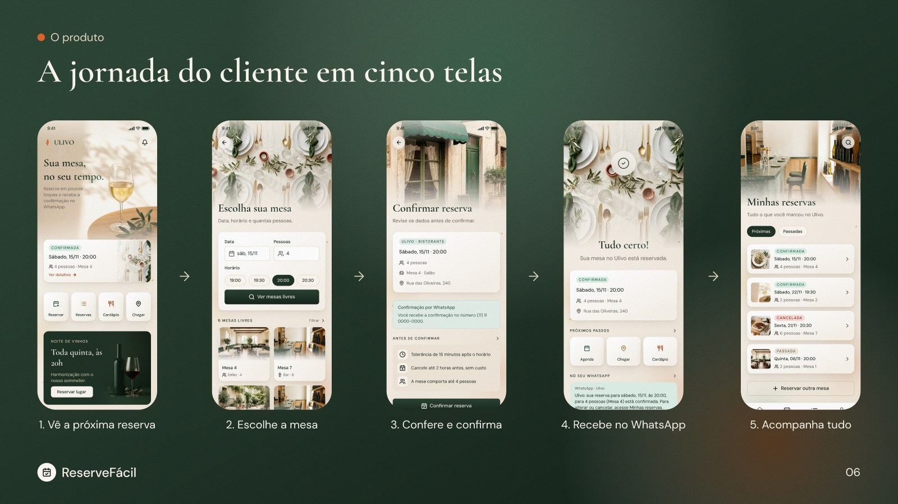
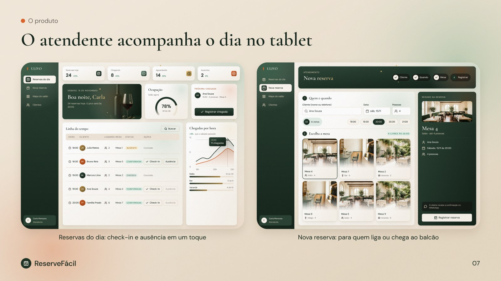
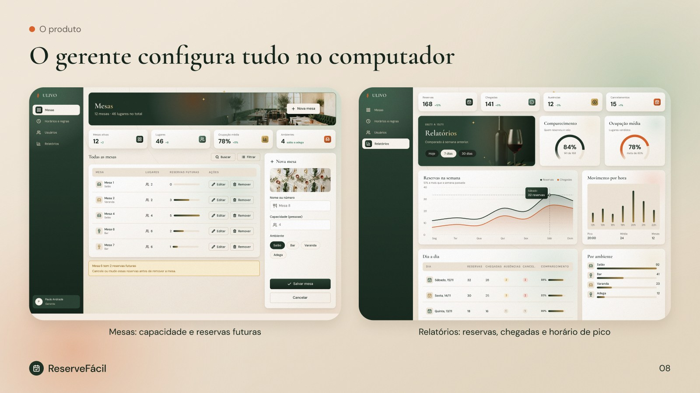
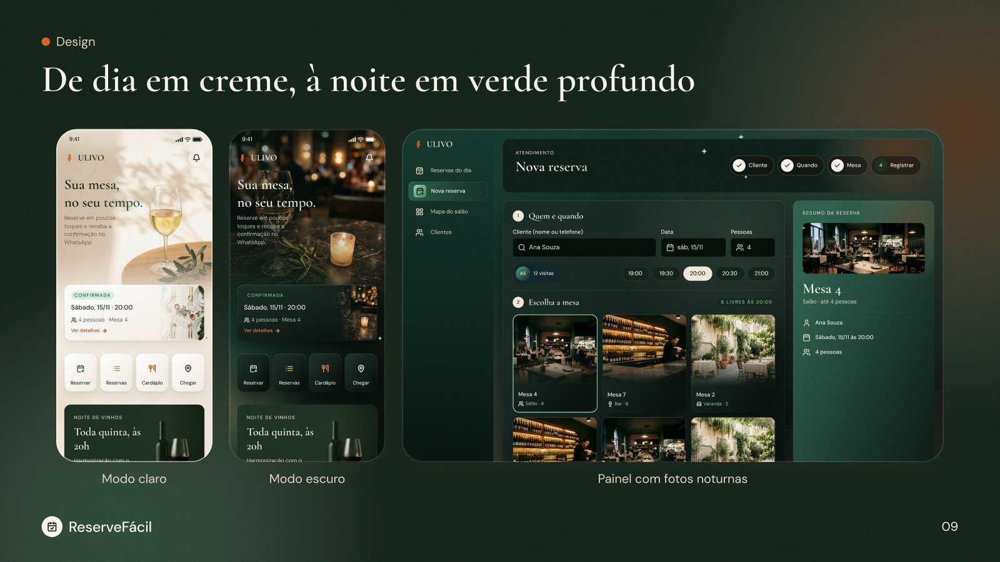
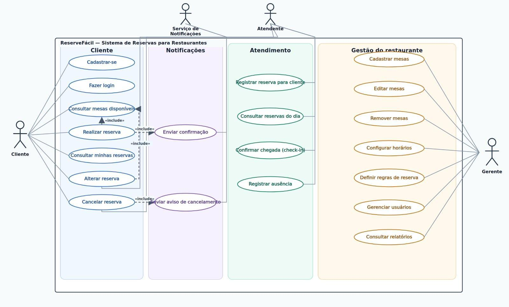
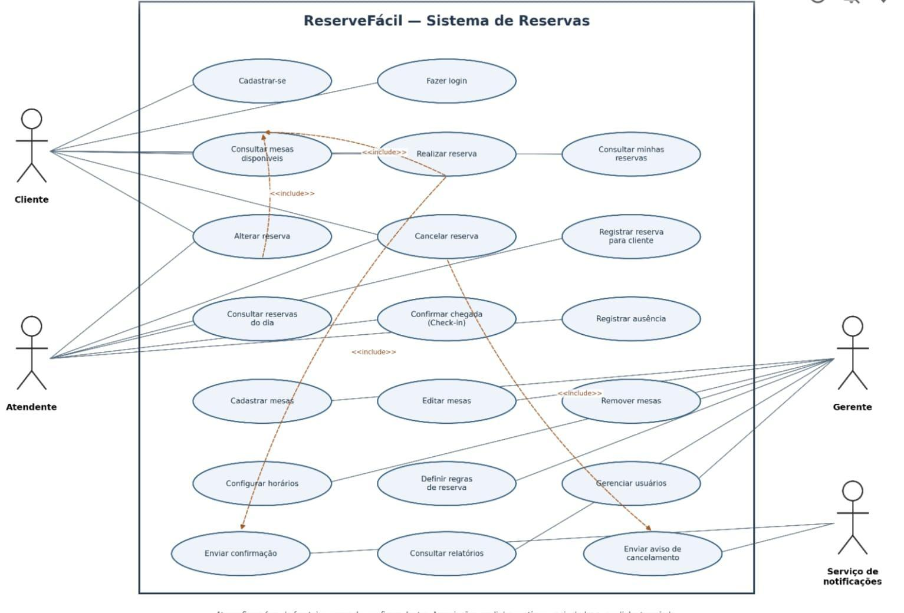
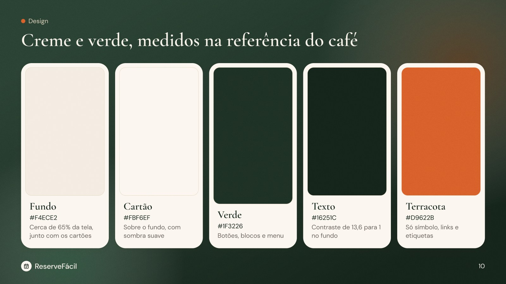
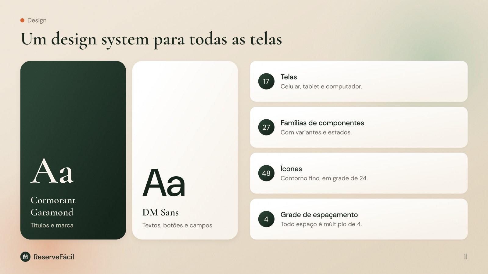
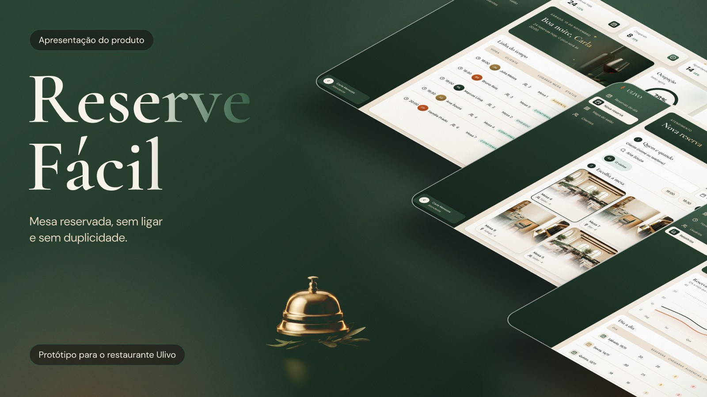

# ReserveFácil

Sistema de reserva de mesas para restaurantes: o cliente reserva, o atendente acompanha o dia e o gerente configura. Cada restaurante contrata o sistema com a própria marca. Neste protótipo, a marca é o **Ulivo**, um restaurante fictício.

Este repositório é um trabalho da faculdade e termina no protótipo de alta fidelidade ([decisão 4](pipeline/decisions/processo-de-trabalho/0004-projeto-termina-no-prototipo-de-alta-fidelidade.md)). O sistema não foi construído.

## Abrir no Figma

| O quê | Link |
|---|---|
| Capa | [Abrir](https://www.figma.com/design/HXJrsNhPSf2iC8GyJBqwi2/ReserveFacil?node-id=107-6054) |
| Alta fidelidade, 17 telas | [Modo claro](https://www.figma.com/design/HXJrsNhPSf2iC8GyJBqwi2/ReserveFacil?node-id=107-2298) e [modo escuro](https://www.figma.com/design/HXJrsNhPSf2iC8GyJBqwi2/ReserveFacil?node-id=114-2310) |
| Apresentação, 13 slides | [Abrir](https://www.figma.com/design/HXJrsNhPSf2iC8GyJBqwi2/ReserveFacil?node-id=107-5186) |
| Design system | [Abrir](https://www.figma.com/design/HXJrsNhPSf2iC8GyJBqwi2/ReserveFacil?node-id=22-2) |
| Wireframe | [Abrir](https://www.figma.com/design/HXJrsNhPSf2iC8GyJBqwi2/ReserveFacil?node-id=5-26) |

## O problema

Restaurantes que recebem pedidos por telefone, mensagem ou no balcão sofrem com reservas duplicadas, informação perdida e dificuldade para alterar ou cancelar. O ReserveFácil reúne tudo num sistema só.

## As telas

**Cliente, no celular**

**Atendente, no tablet**

**Gerente, no computador**

## Modo escuro

## Casos de uso

Diagramas originais do levantamento de requisitos ([texto completo](docs/requisitos-reservefacil.md)).

## Design

Creme e verde, com as cores medidas nas referências do café ([decisão 12](pipeline/decisions/interface/0012-creme-e-verde-medidos-na-referencia-do-cafe.md)), com modo escuro e painéis ricos ([decisão 15](pipeline/decisions/interface/0015-versao-2-oficial-com-modo-escuro.md)). Detalhes em [docs/design-system.md](docs/design-system.md).

## Apresentação

São 13 slides para apresentar o produto, com o roteiro de fala em [apresentacao.md](pipeline/04e-high-fidelity/apresentacao.md).

## Próxima versão

O que ficou para depois está em [proxima-versao.md](pipeline/04e-high-fidelity/proxima-versao.md).

## Como trabalhar neste projeto

- Regras do agente e do projeto: [AGENTS.md](AGENTS.md).
- Como uma mudança chega na `main`: [CONTRIBUTING.md](CONTRIBUTING.md).
- Onde o trabalho parou: [pipeline/STATE.md](pipeline/STATE.md).
- Decisões tomadas: [pipeline/decisions](pipeline/decisions/README.md).
- Histórico de versões: [CHANGELOG.md](CHANGELOG.md).
